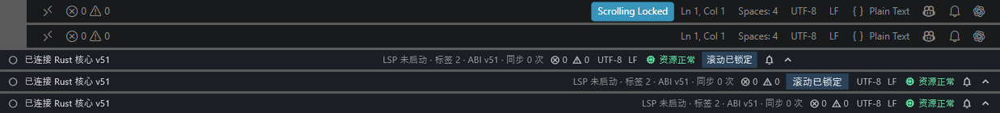

# P05.373 滚动锁定状态栏固定版对照

固定 Code-OSS 4bda7217fc83e8e838b1edd9ebaf21bb9b498c7e 在滚动锁定生效时显示右侧首项，位置在选区、缩进、编码和行尾格式之前。入口带突出背景，点击后消失。Alula 基线把入口排在编码和行尾格式之后，右侧通知位置随锁定显隐变化。调整后，锁定入口位于文件状态项之前，右侧控件贴齐栏尾。

## Windows 固定版本和 Alula

在 Windows 125% DPI、独立未激活的 WinSta0 测试桌面加载相同的 LF 文本字节。参考窗口和 Alula 内容视口分别为 1204 和 1236.8 逻辑像素宽。按逻辑像素裁出状态栏并右对齐。此次验收记录相对位置、显隐、点击和 2 像素上下间距。Alula 配色、译文和 24 像素栏高与参考版存在差异。

下图依次为固定版开启、固定版关闭、Alula 基线开启、修复版开启、修复版点击后关闭。

| 度量 | 固定版 | Alula 基线 | Alula 修复后 |
| --- | --- | --- | --- |
| 位置 | 先于右侧文件状态项 | 晚于编码和行尾 | 先于编码和行尾 |
| 栏高 / 入口高 | 28 / 24 | 24 / 20 | 24 / 20 |
| 上下间距 | 2 / 2 | 2 / 2 | 2 / 2 |
| 标签字号 / 水平内边距 | 12 / 8 | 11 / 6 | 12 / 8 |
| Alula 通知铃铛右侧间距 | — | 关闭 316.51，开启 278.39 | 三个状态均为 34.0 |

Windows 和独立 Linux Xvfb/Xfwm4 中的 Flutter Release 渲染均验证开关状态、点击后的消失、栏尾控件位置和正常退出。夹具调用实际 Toggle 命令，并在释放构建中由 Flutter 命中测试投递点击。此前 P05.367 和 P05.368 覆盖系统指针入口、主辅窗同步与紧凑模式。Windows 实际输入桌面未切换。参考版在抓取完成后由独立 JobObject 回收。[原生回执、坐标与构建哈希](p05.373-locked-scroll-visual/native.json)。

## LAY-15 已验证场景

| 场景 | 入口和结果 | 原生证据 |
| --- | --- | --- |
| 常驻 Toggle | 命令面板和状态栏切换有效锁定。关闭后独立滚动 | [P05.367](p05.367-lock-scroll-status.md) |
| 临时 Hold | 单键、组合键、反转常驻开关、释放与失焦。跨窗重复键保持原状态，真实重新按下可再次触发 | [P05.365](p05.365-locked-scroll-hold.md)、[P05.370](p05.370-auxiliary-scroll-hold.md)、[P05.371](p05.371-cross-window-hold-repeat.md) |
| 同窗跨组及同组拆分 | 横纵位移以各视图起点为基准。不同文档长度、超出范围后反向返回及布局变化可重取起点 | [P05.363](p05.363-locked-scroll-origin.md)、[P05.364](p05.364-locked-scroll-horizontal.md) |
| 主窗和两辅助窗 | 有效状态跨窗同步，紧凑辅助窗隐藏状态项。三窗两轴位移、限位、解除锁定和退出协议已复验 | [P05.368](p05.368-auxiliary-lock-status.md)、[P05.369](p05.369-cross-window-scroll.md)、[P05.372](p05.372-main-close-with-auxiliary.md) |
| 状态栏相对视觉位置 | 固定版与 Alula 的 Windows 对照及两个平台的发布构建观测见上 | [坐标与截图来源](p05.373-locked-scroll-visual/native.json) |

## 门禁

- 定向 27/27。新增的断言在基线捕获栏尾空白，并覆盖编码与行尾顺序、通知铃铛位置稳定以及点击关闭。Flutter 全量 1,990 项通过、2 项跳过，Rust fmt、核心构建、workspace tests、Clippy、Flutter analyze 和离线锁定依赖通过。
- GitNexus 类级影响为 LOW，涉及主窗状态栏与共享辅助窗状态项。Flutter 通过框架分派的 build 方法图谱未解析调用方，已用类级调用和源文件核对。全量与暂存检测覆盖 4 个文件和 6 处变更。
- 产品 26d03118e7aa6d969f86f11db6ffc55bad499890。CI 四项及 Platform Availability Windows/Linux 通过。登记时 macOS 托管状态为 in_progress，实机暂缓。[产品 CI 46116127507](https://github.com/Eternal-Wanderer-Vegetable/Alula_Code/actions/runs/46116127507)。[Platform Availability 46116120872](https://github.com/Eternal-Wanderer-Vegetable/Alula_Code/actions/runs/46116120872)。[托管回执](p05.373-locked-scroll-visual/hosted.json)。
