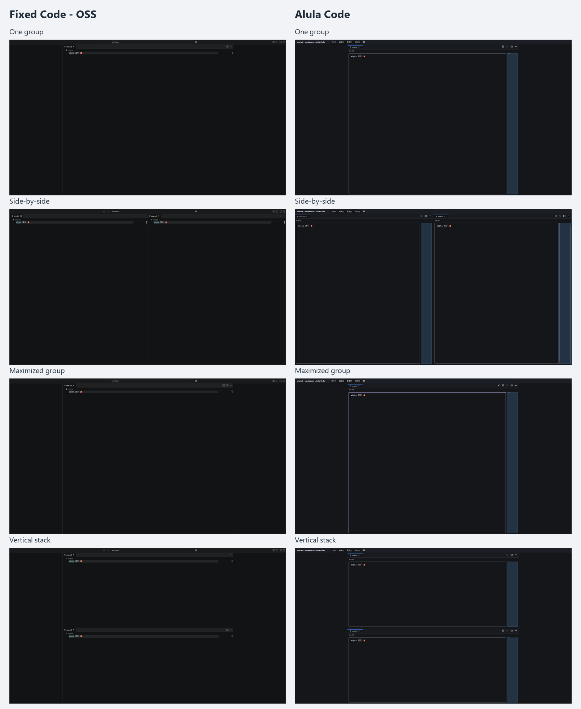

# P05.385 普通文本在默认 Zen 布局中的居中宽度

默认 Zen 以可用编辑器宽度的 19.09% 计算每侧留白。水平多列使用整个范围。单列、纵向堆叠和最大化组应用同一比例。布局沿用现有组状态和最小宽度。本用例对应 `parity-lay-14` 的 `workbench.action.toggleZenMode` 进入和退出，以及组拆分和最大化后的宽度。

## 固定版和双端发布验证

- 固定 Code-OSS 4bda7217fc83e8e838b1edd9ebaf21bb9b498c7e 在 Windows 125% DPI 下，普通居中模式测得内容宽度 562.4、852.4、1412.4，左侧留白 107、162、269 逻辑像素。Zen 测得内容宽度 2038.4、左侧留白 389。创建水平列取消留白，最大化、关闭额外水平组或创建纵向组恢复留白，退出恢复窗体。
- 两端使用同一段含 BOM、CRLF、中文与 Emoji 的文件，文件字节和系统关窗均通过。Windows 私有桌面与 Linux Xvfb/Xfwm4 上用已注册工作台命令触发布局，以系统状态和实际渲染边界核验。逻辑宽度/单边留白为 Windows 2048/390、Linux 1920 1920/366、Linux 1280 1280/244。两端最大化前和还原后各编辑组边界一致。Linux 两种尺寸使用同一个 AOT。
- 比较基准是各自可用编辑器内容宽度，固定版外层客户区框在 Windows 两侧约 4.8 逻辑像素。2048 视口下 Alula 从 x=390 起排，固定版从 x≈394 起排；绝对边界、组宽分配及截图中的编辑器样式仍有差异。复杂编辑器与配置入口另有待核对场景。[固定版与双端原生回执](p05.385-zen-centered-layout/native.json)。

图中记录同一 2048 × 1152 逻辑视口、125% DPI 与同一文本的发布渲染。两列并排缩放显示，原始尺寸与截图哈希见原生回执。

## 门禁

- 新增回归复现旧 Zen 固定宽度。修复后定向 24/24，专题 281/281，全量 Flutter 2,020 项通过、2 项跳过。Rust fmt、核心构建、workspace tests、Clippy、Flutter analyze 和锁定依赖校验通过。
- GitNexus 全量与暂存各覆盖 4 个文件、5 处变更。框架入口、居中布局和状态类的影响回执随托管证据登记。
- 产品 525bc5547db4f1c21e66c126332e70db0693e120。CI 四项和 Platform Availability Windows/Linux 通过。登记时 macOS 托管状态为 in_progress，实机暂缓。[产品 CI 46151540561](https://github.com/Eternal-Wanderer-Vegetable/Alula_Code/actions/runs/46151540561)。[Platform Availability 46151537543](https://github.com/Eternal-Wanderer-Vegetable/Alula_Code/actions/runs/46151537543)。[托管回执](p05.385-zen-centered-layout/hosted.json)。
